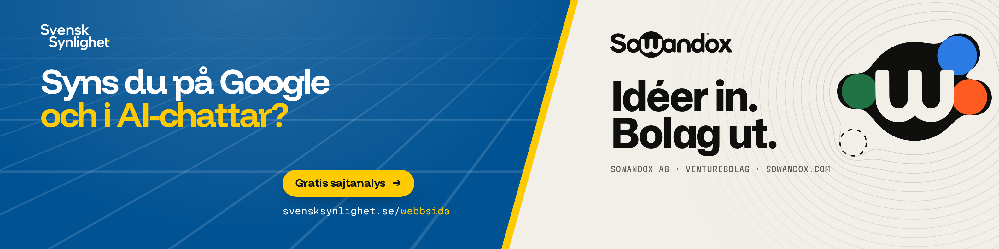

# Hej, jag heter Casper

Grundare av **[Svensk Synlighet](https://svensksynlighet.se)** och **[Sowandox](https://sowandox.com)**. Jag bygger hemsidor, system och bolag, med AI-agenter som en del av teamet.

### Vad jag jobbar med

- **[Svensk Synlighet](https://svensksynlighet.se)**: webbyrå i Skåne. Sajter, system och sociala medier som gör företag synliga på Google och i AI-chattar. [Gratis sajtanalys →](https://svensksynlighet.se/webbsida)
- **[Sowandox](https://sowandox.com)**: venturebolag. Idéer in. Bolag ut.

### Så bygger jag

Next.js · React · TypeScript · Tailwind CSS · Firebase · Vercel, och AI-agenter i varje steg, från kod till drift.

De flesta repon är privata kundprojekt, så grafen nedan säger mer än listan.

### Hitta mig

[weinelin.se](https://weinelin.se) · [LinkedIn](https://www.linkedin.com/in/casper-weinelin-7382a01ab/) · [X](https://x.com/CasperWeinelin) · [YouTube](https://www.youtube.com/@CasperWeinelin)
